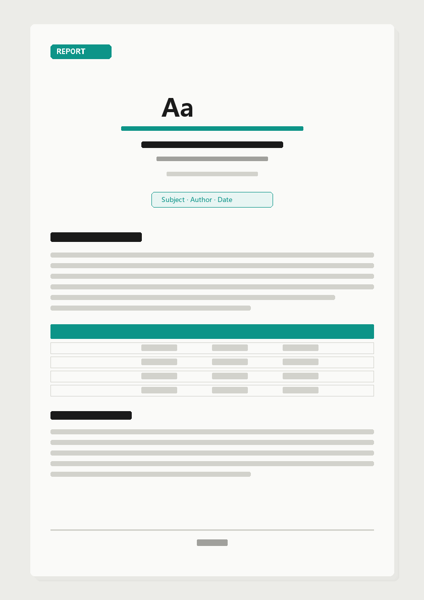
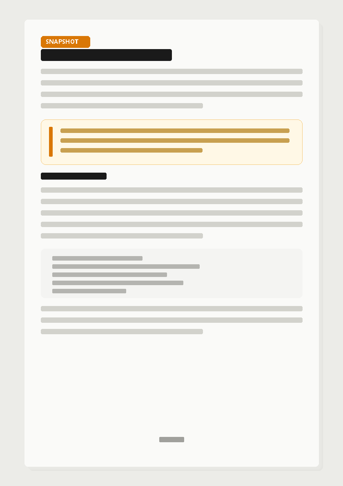
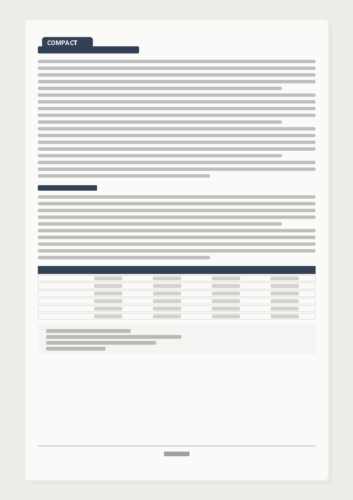
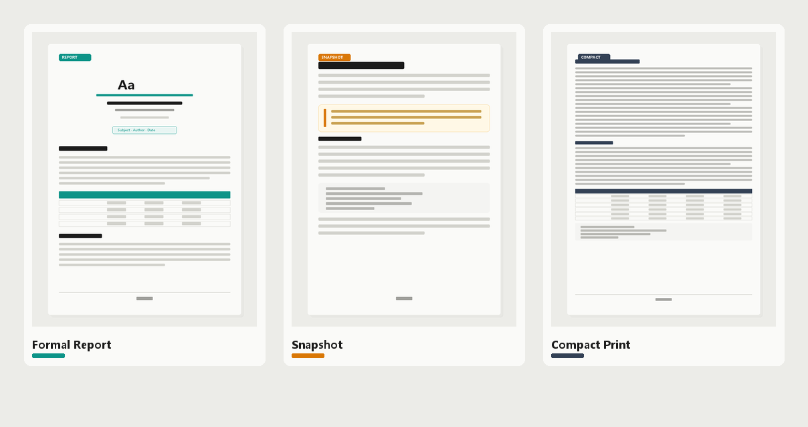

# PDF-export · Beautiful PDF Export for Obsidian

**English** | [中文](README.zh-CN.md)

> **Repository**: https://github.com/JerommeWEI/j-studio-export  
> **Version**: v0.4.1 · **Author**: [JerommeWEI](https://github.com/JerommeWEI)  
> **Platform**: Desktop Obsidian (`isDesktopOnly`)

Export any Obsidian note as a **formal, printable, deliverable** A4 PDF — with cover, table of contents (real page numbers), running headers, footer page numbers, and elegant pagination. Not the built-in export that breaks pages, warps styles, and feels unfinished.

---

## Preview

Conceptual mockups of the three export presets (illustrative, not live screenshots):

| Formal Report | Snapshot | Compact Print |
|:---:|:---:|:---:|
|  |  |  |



- **Formal Report** — cover + TOC with real page numbers + headers/footers; H1 starts a new page
- **Snapshot** — close to Obsidian reading feel: airier leading, bold body text
- **Compact Print** — smaller type, tighter leading, narrow margins for paper

---

## Why this plugin

| Pain point | What this plugin does |
|------|----------------|
| Built-in PDF export breaks pages and clips charts | Paged.js engine; table headers repeat across pages; orphan/widow control |
| Styles drift from Reading view | Collects real vault CSS, sanitizes it, injects for typesetting |
| No formal document feel (cover / TOC / headers) | “Formal Report” preset: cover + auto TOC + headers + page numbers |
| Charts, Mermaid, math don’t export | Uses Obsidian’s renderer; images embedded as base64 |
| Want a faithful archive / paper-friendly print | “Snapshot” and “Compact Print” presets |

Good for: project close-out reports, calibration/lab notes, weekly archives, handoff docs for colleagues and leads, printed handouts.

---

## Quick start

1. **Install**
   - Community plugins: search **PDF-export** (recommended)
   - Or manually: drop `main.js` / `manifest.json` / `styles.css` from the Release into  
     `.obsidian/plugins/j-studio-export/`
2. **Enable**: Settings → Community plugins → turn on **PDF-export**
3. **Export**
   - Click the 📄 download icon in the left ribbon, or
   - Command palette (`Ctrl/Cmd+P`):

| Command | What it does |
|------|------|
| **Export current note as beautiful PDF** | Opens a dialog to pick preset and options |
| **Quick export (skip dialog, use default preset)** | Exports immediately with the default preset |

### Export dialog

- Top: **Export PDF** / **Export HTML** (HTML for sharing or browser `Ctrl+P` fallback)
- Three preset cards: Formal Report / Snapshot / Compact Print
- Card-style toggles (label left, switch right): cover page, TOC page, headers, page numbers

---

## Three presets

| Preset | Character | Best for |
|------|------|------|
| **Formal Report** | Cover + TOC (real page numbers) + headers/footers; H1 starts a new page; proper A4 document | Delivery, archive, leadership |
| **Snapshot** | Close to Obsidian reading feel: looser leading, bold body | Archival snapshot, side-by-side compare |
| **Compact Print** | Small type, dense leading, narrow margins | Paper, handouts, save ink |

**Cover metadata** (frontmatter, with sensible fallbacks):

```yaml
title: Document title
subtitle: Subtitle
subject: Section / topic (e.g. Venus Product)
author: Byline
date: 2026-10-13
kicker: Small header text (optional)
```

The first H1 that matches the document title is auto-hidden so it does not repeat on the cover and body.

---

## How it works

```
Note (.md)
  → Obsidian MarkdownRenderer (Dataview / Mermaid / Excalidraw / math all real-rendered)
  → Images inlined as base64 + vault CSS collected
  → CSS sanitize (drop selectors Paged.js can’t handle, strip @media print)
  → Styles injected screen-only (real styles for pagination measurement; print styles only from presets/)
  → Paged.js 0.4.3 pagination (page numbers / headers / TOC page numbers)
  → Hidden-window Chromium printToPDF
```

No build step: `main.js` is plain JavaScript. While developing, edit `presets/*.css` and reload the plugin; before release run `node tools/embed-assets.js` to embed presets into `main.js`.

---

## Changelog

### v0.4.1

- **Bilingual README**: English (`README.md`) and Chinese (`README.zh-CN.md`) with a language switcher at the top
- **Preview illustrations**: conceptual mockups of the three presets (`docs/images/`) so the README shows rendering effects, not only text

### v0.4.0

- **Copy button removed from export**: Obsidian’s code-block “copy” icon no longer appears in PDFs (DOM strip + CSS fallback)
- **Consistent top-of-page gap**: spacing is applied to each page’s content area (`pagedjs_page_content`), so code blocks / paragraphs / headings share the same header-to-first-line distance, and **no extra blank bar appears inside gray code blocks**
- Community review cleanup: standard MIT LICENSE, manifest description punctuation, fewer unnecessary `!important`s

### v0.3.0

- **True top-of-page gap for body pages**: `margin-top` at page breaks collapses, so content on page 2+ stuck to the header; switched to `padding-top`
  - Headings (h1–h4) and body blocks (paragraphs / lists / quotes / code / tables) share one “header → first line” gap
  - Formal Report header-to-body gap increased (`padding-bottom` 4mm → 7mm)
- Mid-page paragraph spacing changed to `margin-bottom` + `padding-top` so the unified gap does not explode paragraph spacing

### v0.2.0

- **Export dialog buttons fixed**: bottom buttons were clipped under some themes; now pinned to the top
- **Dialog scrolls**: tall content is no longer truncated
- **Toggle cards**: tinted sections, label left / switch right
- Author field set to **JerommeWEI**

### v0.1.0

- First release: three presets, Paged.js pagination, cover / TOC / headers + page numbers, HTML fallback export

---

## Settings

| Setting | Description |
|------|------|
| Default preset | Preset preselected when the dialog opens |
| Author name | Cover byline |
| Output location | Ask every time (Save As) / write next to the note |
| Open after export | Open the file when export finishes |
| Custom CSS | Appended after all presets; highest priority |

---

## File structure

```
j-studio-export/
├── manifest.json              # Plugin manifest (version, author, minAppVersion)
├── main.js                    # Export pipeline + embedded-asset fallback
├── styles.css                 # Export dialog / settings UI
├── versions.json              # Version → minAppVersion map
├── presets/                   # Typesetting styles (day-to-day iteration entry)
│   ├── _base.css              # Element styles, break guards, cover/TOC skeleton
│   ├── report.css             # Formal Report
│   ├── snapshot.css           # Snapshot
│   └── compact.css            # Compact Print
├── vendor/paged.polyfill.js   # Paged.js 0.4.3
├── tools/embed-assets.js      # Before release: embed presets/vendor into main.js
└── docs/images/               # Conceptual preview mockups for README
```

`dev-test/` is a local verification loop (not shipped in Release):

```bash
cd .obsidian/plugins/j-studio-export/dev-test
node build-test.js report    # sample content → HTML
node render.js report        # Chrome render → PDF + screenshot
node verify.js report        # DOM/pixel assertions
node pdf-check.js report     # PDF text assertions
```

---

## Typesetting iteration notes

1. Rules that affect measurement (type size, leading, spacing) live in `presets/*.css`, scoped with `.jx-export .jx-content` to beat `app.css`
2. **Do not rely on `@media print`** — print styles come only from presets
3. **Top-of-page gap uses `padding-top`, not `margin-top`** — margins collapse at page breaks
4. After editing presets, run `node tools/embed-assets.js` before release

### Known pitfalls (Paged.js scars)

- Must use **Paged.js 0.4.3** (0.5.0-beta margin box / break is broken)
- Selectors with `:is(a,b)` and commas fail the whole pagination (0 pages) — must go through `css-sanitize`
- `leader()` is unsupported; TOC dots use flex + a dotted span
- `app.css`’s `html, body { height: 100% }` clips page 2+ in print — collected styles are screen-only

---

## Known limits

- Code blocks use Cascadia Code / Consolas (preview icon fonts are not for code)
- Frosted glass is not real on paper; the Snapshot preset translates it into equivalent print typesetting
- Audio / video / iframe embeds are not included in PDFs
- A few CJK characters may copy as radical variants (Chromium + Source Han CMap quirk; rendering is fine)
- If silent print is unavailable, falls back to “export self-contained HTML + browser `Ctrl+P` guidance”

### Permissions (for reviewers and users)

Export must **write PDF / HTML files locally**, so the plugin uses Node `fs` to write files and read `presets/`, `vendor/` static assets. Note content is read via Obsidian’s `vault.read` API. No network upload, no telemetry.

---

## License

[MIT](LICENSE).

Bundles [Paged.js](https://gitlab.coko.foundation/pagedjs/pagedjs) v0.4.3, also MIT.
